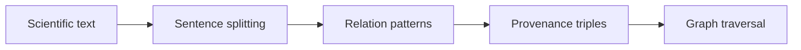

# Scientific-Knowledge-Graph

**Scientific relation extraction and provenance-aware traversal**

 

## Overview

Scientific relation extraction and provenance-aware traversal. This compact, dependency-free Python baseline is intended for reproducible experimentation and extension.

## Architecture



## Quick start

```bash
git clone https://github.com/rohanst14/Scientific-Knowledge-Graph.git
cd Scientific-Knowledge-Graph
python -m pip install -e .
python examples/demo.py
python -m unittest discover -s tests -v
```

## Example

```python
from scientific_knowledge_graph import *
result = extract({'paper-1':'Heat increases pressure. Pressure causes alarm.'})
print(result)
```

## Repository guide

| Path | Purpose |
|---|---|
| [src/scientific_knowledge_graph](src/scientific_knowledge_graph) | Core implementation |
| [examples/demo.py](examples/demo.py) | Runnable synthetic demonstration |
| [tests/test_core.py](tests/test_core.py) | Regression tests |
| [docs/methodology.md](docs/methodology.md) | Method and limitations |

## Limitations

Rule-based prototype; extracted claims are not independently verified causal relationships. No pretrained entity model.

This is an AI-assisted portfolio prototype, not a production system or published scientific result.
